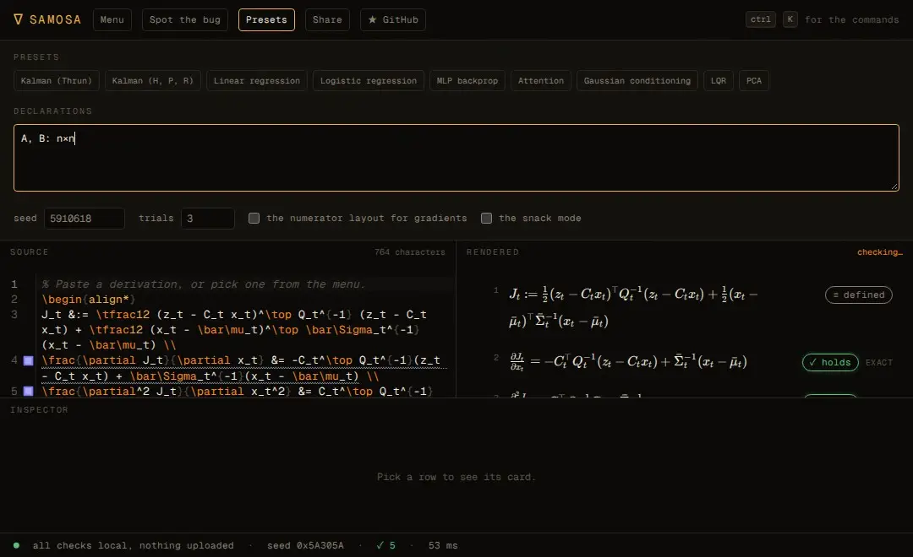
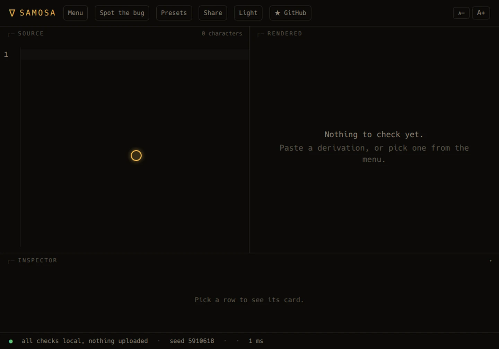

<div align="center">


# SAMOSA

### Step Auditor for Matrix Operations, Stochastics & Algebra

**Check every step of your derivation. Exactly. In your browser.**

[](LICENSE)
[](https://www.typescriptlang.org/)
[](https://react.dev/)
[](https://vite.dev/)
[](https://www.npmjs.com/package/samosa-math)
[](https://github.com/Hussain004/SAMOSA/releases)

[**→ Live demo**](https://samosa-math.vercel.app/app) · [Report a bug](https://github.com/Hussain004/SAMOSA/issues) · [Request a feature](https://github.com/Hussain004/SAMOSA/issues)

</div>

```
     ∇
    ╱ ╲
   ╱   ╲      "A ∇ is just a samosa with filling."
  ╱_____╲
```

SAMOSA is a linter for math derivations. Paste a LaTeX `align` block, a
Markdown note, or the answer a language model gave you, and every row gets
one of these:

- **✓ holds**, with the sizes it was tested at, the number of trials, the
  primes, and the probability that a wrong step slipped through
- **✗ wrong**, with a small counterexample and a fix
- **⊘ shape error**, with the sizes that do not fit
- **? not checked**, with the reason

There is no language model in the verdict path. There is arithmetic, a finite
field, and a probability bound.

---

## Why SAMOSA?

A derivation is a chain of small steps, and the errors are small too. A
transpose in the wrong order. A dropped `+ KQKᵀ`. A factor of two from
treating a non-symmetric matrix as symmetric. A gradient in the wrong layout.

The step that nobody checks is the one that says "after some algebraic
manipulation, we may obtain ...".

SAMOSA started with exactly that step. The Kalman measurement update, as it
is usually written, says

> after some algebraic manipulation we may obtain K = Σ̄Cᵀ(CΣ̄Cᵀ + Q)⁻¹

and that is the one line in the notes that no one ever verified. SAMOSA
checks it, exactly, and it also finds the two ways you can get it wrong.

## What it does

| | |
| --- | --- |
| **Exact, not approximate** | A step that only uses rational operations is checked over GF(2³¹−1) and GF(2147483629). Schwartz-Zippel turns that into a computed bound, usually below 10⁻⁴⁶ per size. |
| **Gradients and Hessians** | Checked with dual numbers, so the layout convention is diagnosed rather than guessed. |
| **Expectations** | The expectation of a polynomial under a Gaussian is computed with a rational quadrature rule, so it is exact too. |
| **Counterexamples** | Shrunken until they are small enough to read, then copied as NumPy. |
| **Fixes** | The common mistakes are tried for you: a transposed product, a missing noise term, a missing assumption. |
| **Your agent** | An MCP server and an Agent Skill, so Claude Code, Codex or Cursor can check their own math. |
| **Your pipeline** | A CLI and a GitHub Action that lint the `align` blocks of a paper. |
| **Your machine** | Everything runs in the browser. The share link lives in the URL fragment. No account, no server, no upload. |

## See it work

**Nineteen seconds.** The line everybody writes and nobody checks, and what
happens when a machine reads it.


**A transposed product.** The squiggle, the counterexample, and the fix that
takes one keystroke.



**The Kalman update, with the missing noise term.** The row everybody writes
from memory, and the term that is not there.



**A gradient in the wrong layout.** The numerator layout is a transpose away
from the right answer, and SAMOSA says so.


The same three, as videos: [the transposed product](public/gifs/transpose.mp4),
[the Kalman update](public/gifs/kalman.mp4), [the layout](public/gifs/gradient.mp4).

## Quick start

```bash
# the web app
npx samosa-math check paper.tex

# the CLI
npx samosa-math check paper.tex --format sarif

# the MCP server, for Claude Code, Codex or Cursor
claude mcp add samosa -- npx -y -p samosa-math samosa-mcp
```

The declarations go in a comment, in the compact syntax:

```latex
% samosa: x_t, \bar\mu_t: n; z_t: m; C_t: m×n; Q_t: spd m; \bar\Sigma_t: spd n
```

## The example

```latex
\begin{align*}
J_t &:= \tfrac12 (z_t - C_t x_t)^\top Q_t^{-1} (z_t - C_t x_t) + \tfrac12 (x_t - \bar\mu_t)^\top \bar\Sigma_t^{-1} (x_t - \bar\mu_t) \\
\frac{\partial J_t}{\partial x_t} &= -C_t^\top Q_t^{-1}(z_t - C_t x_t) + \bar\Sigma_t^{-1}(x_t - \bar\mu_t) \\
\frac{\partial^2 J_t}{\partial x_t^2} &= C_t^\top Q_t^{-1} C_t + \bar\Sigma_t^{-1} \\
\Sigma_t &:= \left(C_t^\top Q_t^{-1} C_t + \bar\Sigma_t^{-1}\right)^{-1} \\
\frac{\partial J_t}{\partial x_t} = 0 &\implies x_t = \bar\mu_t + \Sigma_t C_t^\top Q_t^{-1}(z_t - C_t \bar\mu_t) \\
K_t &:= \Sigma_t C_t^\top Q_t^{-1} \\
K_t &= \bar\Sigma_t C_t^\top \left(C_t \bar\Sigma_t C_t^\top + Q_t\right)^{-1} \\
\Sigma_t &= (I - K_t C_t)\, \bar\Sigma_t
\end{align*}
```

SAMOSA reports every row as holding, at the sizes (3,2), (2,3) and (4,3),
with three trials in each of two primes, and a false checkmark bound below
10⁻⁴⁶ per size.

Now change one thing. Put `Q_t^{-1}` inside the inverse on the push-through
row, and SAMOSA says the two sides are not equal, gives you the smallest
counterexample, and tells you the term you are missing.

## How much of a real paper it reads

Measured, not guessed. The display math of 39 recent papers from cs.LG,
cs.RO and stat.ML, 1498 rows:

| | |
| --- | --- |
| rows SAMOSA can parse | 1300 (**86.8%**) |
| rows SAMOSA reads with no unknown construct | 749 (**50.0%**) |

The gap is rows that parse but contain something SAMOSA does not know, such
as a `\mid` used as a conditional bar, or a macro the authors defined in
their own preamble. The method and the full list of what stops the rest are
in [docs/COVERAGE.md](docs/COVERAGE.md).

And the Cookbook: 48 identities in matrix algebra, calculus and stochastics,
with the mistakes the catalog can make of them.

| | |
| --- | --- |
| the false checkmarks | **0** |
| the caught mutants | 196 of 262 (**74.8%**) |

The plan's gate asks for 95% of the bugs caught. The cookbook is at 74.8%,
and every miss is a step the engine says it cannot decide, never one it
calls right. The method, the misses and the bugs the corpus found are in
[docs/COOKBOOK.md](docs/COOKBOOK.md).

## What it cannot do

Being straight about the edges is part of the product:

- It does not prove theorems. It checks steps.
- It does not check inequalities (`≤`), limits, or series. Those come back
  as `?` with a reason.
- It does not check the prose around the equations.
- It does not understand every notation. When it does not, it says so, and
  tells you which declaration would help.
- It does not know your paper is right. It knows that one row is not.

## The menu

Sixteen derivations that people actually write, each with a correct version
and a planted bug, in the app and in the golden test suite: Woodbury,
Sherman-Morrison, the matrix determinant lemma, the trace identities, the
Kalman update, the Joseph form, least squares, ridge regression, logistic
regression, the softmax cross entropy, a two layer network, the variance of
a Gaussian, the expectation of a quadratic form, the KL of two Gaussians,
the Riccati recursion, and rotations and the cross product.

## The install

| | |
| --- | --- |
| **Web** | [samosa-math.vercel.app/app](https://samosa-math.vercel.app/app), no install |
| **CLI** | `npm i -g samosa-math`, then `samosa check paper.tex`, or `npx samosa-math check paper.tex` |
| **Claude Code** | `claude mcp add samosa -- npx -y -p samosa-math samosa-mcp` |
| **Codex** | `[mcp_servers.samosa]` in `~/.codex/config.toml` |
| **Cursor** | the `mcpServers` entry in `.cursor/mcp.json` |
| **GitHub Action** | `- uses: Hussain004/SAMOSA@v1` |
| **Skill** | `skill/samosa/SKILL.md` |

## How it works

The short version: SAMOSA never rewrites symbols. It samples the objects
your declarations describe, with the structure they ask for, and evaluates
both sides of every step on the same instance. Non-commutativity, structure
and shape all come for free.

The long version, with the probability bounds and the two honest caveats,
is in [docs/HOW_IT_WORKS.md](docs/HOW_IT_WORKS.md).

## The notation

[docs/NOTATION.md](docs/NOTATION.md) has the full list: what a superscript
means, how a symbol is named, what the relations do, and the declaration
syntax in both the LaTeX and the compact form.

## Privacy

Your derivation never leaves your machine. The engine is a Web Worker in
the tab, a share link keeps the derivation in the URL fragment, and the CLI
and the MCP server make no network requests at all. See
[docs/PRIVACY.md](docs/PRIVACY.md).

## Development

```bash
pnpm install
pnpm dev            # the site and the app
pnpm test           # the unit tests
pnpm test:e2e       # the browser tests
pnpm lint
pnpm build          # the site
pnpm build:pkg      # the npm package
```

The engine lives in `src/core` and imports nothing from the DOM or from
Node, so the same code runs in the browser, in the CLI and in the MCP
server. The rules it lives by: no model in the verdict path, never a
checkmark without a guarantee, and nothing that leaves the machine.

## Contributing

Issues and pull requests are welcome. The best ones come with a derivation
that SAMOSA gets wrong: a notation it cannot read, a step it should catch
and does not, or a false checkmark. Those are the bugs that matter.

---

<div align="center">

*If SAMOSA saves you a wrong step, consider giving it a ⭐ on [GitHub](https://github.com/Hussain004/SAMOSA)!*

*Want to support development directly? [Donate here](https://donatr.ee/hussain/)*

</div>
