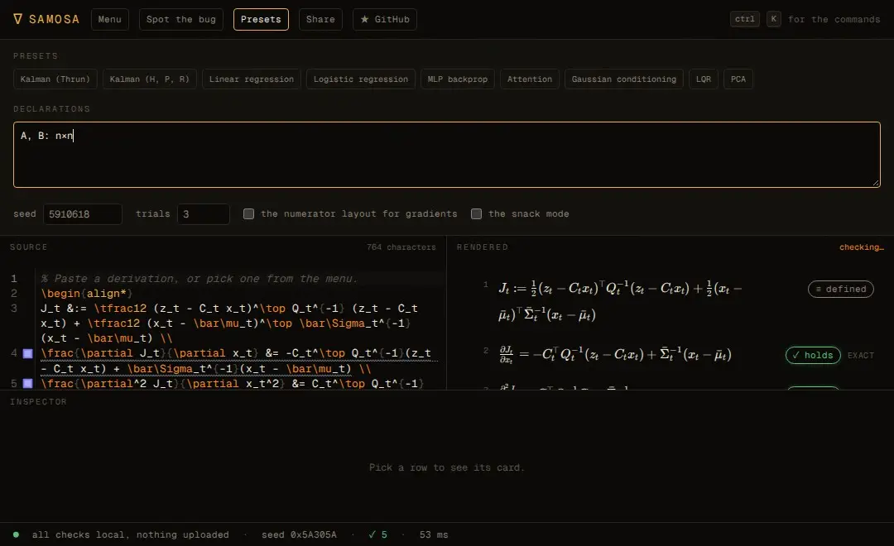
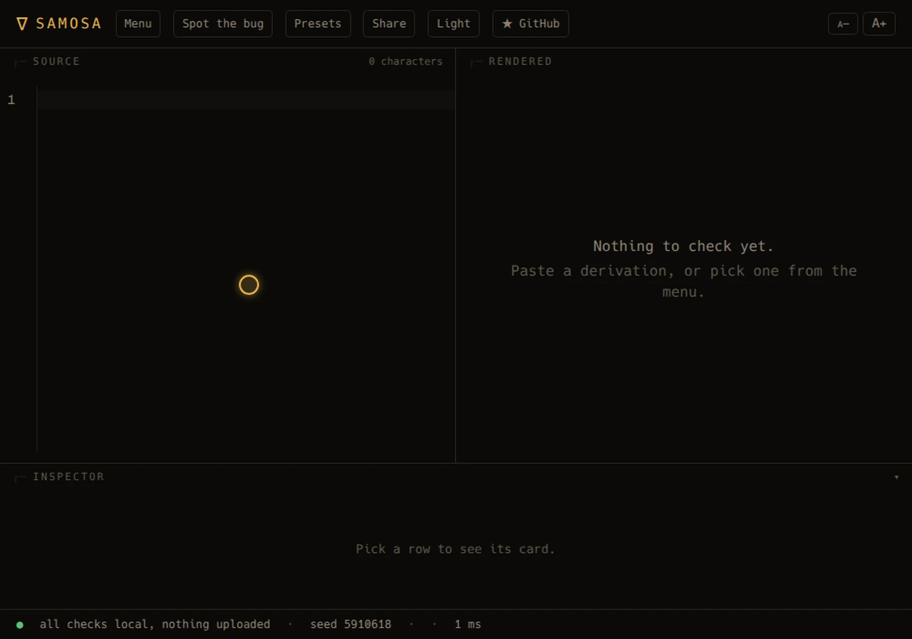

<div align="center">


# SAMOSA

### Step Auditor for Matrix Operations, Stochastics & Algebra

**Check every step of your derivation. Exactly. In your browser.**

[](LICENSE)
[](https://www.typescriptlang.org/)
[](https://react.dev/)
[](https://vite.dev/)
[](https://www.npmjs.com/package/samosa-math)

[**→ Live demo**](https://samosa-math.vercel.app/app) · [Report a bug](https://github.com/Hussain004/SAMOSA/issues) · [Request a feature](https://github.com/Hussain004/SAMOSA/issues)

</div>

```
     ∇
    ╱ ╲
   ╱   ╲      "A ∇ is just a samosa with filling."
  ╱_____╲
```

I built SAMOSA because of the one line nobody checks. You have written it
too: *after some algebraic manipulation, we may obtain ...*; and then the
rest of the proof rides on it. SAMOSA reads the line, evaluates it on
sampled matrices, and tells you whether it holds.

SAMOSA is a linter for math derivations. Paste a LaTeX `align` block, a
Markdown note, or the answer a language model gave you, and every row gets
one of these:

- **✓ holds**, with the sizes it was tested at, the number of trials, the
  primes, and the probability that a wrong step slipped through
- **✗ wrong**, with a small counterexample and a fix
- **⊘ shape error**, with the sizes that do not fit
- **? not checked**, with the reason

There is no language model in the verdict path. There is arithmetic, a finite
field, and a probability bound.

## Why a linter for math

A derivation is a chain of small steps, and the mistakes are small too. A
transpose in the wrong order. A dropped `+ KQKᵀ`. A factor of two from
treating a non-symmetric matrix as symmetric. A gradient in the wrong
layout. Each is invisible to the eye trained on the page, and each is
fatal three pages later.

SAMOSA started with the Kalman measurement update, as it is usually written:

> after some algebraic manipulation we may obtain K = Σ̄Cᵀ(CΣ̄Cᵀ + Q)⁻¹

That is the one line in the notes that no one ever verified. SAMOSA checks
it, exactly, and it also finds the two ways you can get it wrong. I have
yet to meet the paper whose derivations survive unchanged.

## Quick start

```bash
# the web app
https://samosa-math.vercel.app/app

# the CLI
npx samosa-math check paper.tex --format sarif

# the MCP server, for Claude Code, Codex or Cursor
claude mcp add samosa -- npx -y -p samosa-math samosa-mcp
```

No account, no server, no upload. The web app runs the engine in a worker in
the tab, and the share link keeps the derivation in the URL fragment. The
CLI and the MCP server make no network requests at all.

Declarations go in a comment, in the compact syntax:

```latex
% samosa: x_t, \bar\mu_t: n; z_t: m; C_t: m×n; Q_t: spd m; \bar\Sigma_t: spd n
```

| | |
| --- | --- |
| **Web** | [samosa-math.vercel.app/app](https://samosa-math.vercel.app/app), no install |
| **CLI** | `npm i -g samosa-math`, then `samosa check paper.tex`, or `npx samosa-math check paper.tex` |
| **Claude Code** | `claude mcp add samosa -- npx -y -p samosa-math samosa-mcp` |
| **Codex** | `[mcp_servers.samosa]` in `~/.codex/config.toml` |
| **Cursor** | the `mcpServers` entry in `.cursor/mcp.json` |
| **GitHub Action** | `- uses: Hussain004/SAMOSA@v1` |
| **Skill** | `skill/samosa/SKILL.md` |

## What it catches

| | |
| --- | --- |
| **Exact, not approximate** | A step that only uses rational operations is checked over GF(2³¹−1) and GF(2147483629). Schwartz-Zippel turns that into a computed bound, usually below 10⁻⁴⁶ per size. |
| **Gradients and Hessians** | Checked with dual numbers, so the layout convention is diagnosed rather than guessed. |
| **Expectations** | The expectation of a polynomial under a Gaussian is computed with a rational quadrature rule, so it is exact too. |
| **Counterexamples** | Shrunken until they are small enough to read, then copied as NumPy. |
| **Fixes** | The common mistakes are tried for you: a transposed product, a missing noise term, a missing assumption. |
| **Your agent** | An MCP server and an Agent Skill, so Claude Code, Codex or Cursor can check their own math. |
| **Your pipeline** | A CLI and a GitHub Action that lint the `align` blocks of a paper. |

## See it work

**Nineteen seconds.** The line everybody writes and nobody checks, and what
happens when a machine reads it.

<p align="center">
  
</p>

**A transposed product.** The squiggle, the counterexample, and the fix that
takes one keystroke.

<p align="center">
  
</p>

**The Kalman update, with the missing noise term.** The row everybody writes
from memory, and the term that is not there.

<p align="center">
  
</p>

**A gradient in the wrong layout.** The numerator layout is a transpose away
from the right answer, and SAMOSA says so.

<p align="center">
  
</p>

## The example

```latex
\begin{align*}
J_t &:= \tfrac12 (z_t - C_t x_t)^\top Q_t^{-1} (z_t - C_t x_t) + \tfrac12 (x_t - \bar\mu_t)^\top \bar\Sigma_t^{-1} (x_t - \bar\mu_t) \\
\frac{\partial J_t}{\partial x_t} &= -C_t^\top Q_t^{-1}(z_t - C_t x_t) + \bar\Sigma_t^{-1}(x_t - \bar\mu_t) \\
\frac{\partial^2 J_t}{\partial x_t^2} &= C_t^\top Q_t^{-1} C_t + \bar\Sigma_t^{-1} \\
\Sigma_t &:= \left(C_t^\top Q_t^{-1} C_t + \bar\Sigma_t^{-1}\right)^{-1} \\
\frac{\partial J_t}{\partial x_t} = 0 &\implies x_t = \bar\mu_t + \Sigma_t C_t^\top Q_t^{-1}(z_t - C_t \bar\mu_t) \\
K_t &:= \Sigma_t C_t^\top Q_t^{-1} \\
K_t &= \bar\Sigma_t C_t^\top \left(C_t \bar\Sigma_t C_t^\top + Q_t\right)^{-1} \\
\Sigma_t &= (I - K_t C_t)\, \bar\Sigma_t
\end{align*}
```

SAMOSA reports every row as holding, at the sizes (3,2), (2,3) and (4,3),
with three trials in each of two primes, and a false checkmark bound below
10⁻⁴⁶ per size.

Now change one thing. Put `Q_t^{-1}` inside the inverse on the push-through
row, and SAMOSA says the two sides are not equal, gives you the smallest
counterexample, and tells you the term you are missing.

## What it reads, and what it does not

Measured, not guessed. I ran SAMOSA over the display math of 36 recent
papers from cs.LG, cs.RO and stat.ML: 1416 rows, of which 197 make no
claim and are excluded. Of the 1219 claim rows:

| | |
| --- | --- |
| rows that parse end to end | 686 (**56.3%**) |
| rows with no unknown construct | 304 (**24.9%**) |

That is 21.5% of all 1416 display rows. The first version of this table
parsed only the first expression of each row and reported 86.8% and 50.0%.
It was lenient, and this one replaces it. What stops the rest is a `cases`
block inside a probability, a script on something that is not a symbol, a
set the parser cannot close, and the macros the authors define themselves.
The method, the correction and the full list of what stops the rest are in
[docs/COVERAGE.md](https://raw.githubusercontent.com/Hussain004/SAMOSA/master/docs/COVERAGE.md).

<!-- gen:cookbook -->
And the Cookbook: 94 identities in matrix algebra, calculus and stochastics,
with the mistakes the catalog can make of them.

| | |
| --- | --- |
| the false checkmarks | **0** |
| the identities SAMOSA cannot check | **1** |
| the mutation score | **343 of 343 (100.0%)** |
| the harmless mutants, where the mistake changes nothing | **108** |
| the raw rate | **343 of 451 (76.1%)** |

The plan's gate asks for 95% of the bugs caught; the mutation score is 100.0%,
and every mutant the engine calls right is confirmed harmless by the float64
oracle. The method, the misses and the 0 gaps the corpus found are
in [docs/COOKBOOK.md](https://raw.githubusercontent.com/Hussain004/SAMOSA/master/docs/COOKBOOK.md).
<!-- /gen:cookbook -->

## What it cannot do

I would rather tell you than have you find out at hour three:

- It does not prove theorems. It checks steps.
- It does not check inequalities (`≤`), limits, or series. Those come back
  as `?` with a reason.
- It does not check the prose around the equations.
- It does not understand every notation. When it does not, it says so, and
  tells you which declaration would help.
- It does not know your paper is right. It knows that one row is not.

## The menu

Sixteen derivations that people actually write, each with a correct version
and a planted bug, in the app and in the golden test suite: Woodbury,
Sherman-Morrison, the matrix determinant lemma, the trace identities, the
Kalman update, the Joseph form, least squares, ridge regression, logistic
regression, the softmax cross entropy, a two layer network, the variance of
a Gaussian, the expectation of a quadratic form, the KL of two Gaussians,
the Riccati recursion, and rotations and the cross product.

## How it works, and the fine print

The short version: SAMOSA never rewrites symbols. It samples the objects
your declarations describe, with the structure they ask for, and evaluates
both sides of every step on the same instance. Non-commutativity, structure
and shape all come for free.

The long version, with the probability bounds and the two honest caveats,
is in [docs/HOW_IT_WORKS.md](https://raw.githubusercontent.com/Hussain004/SAMOSA/master/docs/HOW_IT_WORKS.md).

The full list of what a superscript means and how declarations work, in
both the LaTeX and the compact form: [docs/NOTATION.md](https://raw.githubusercontent.com/Hussain004/SAMOSA/master/docs/NOTATION.md).

Your derivation never leaves your machine: the engine is a Web Worker in
the tab, a share link keeps the derivation in the URL fragment, and the CLI
and the MCP server make no network requests at all. See
[docs/PRIVACY.md](https://raw.githubusercontent.com/Hussain004/SAMOSA/master/docs/PRIVACY.md).

## Development

```bash
pnpm install
pnpm dev            # the site and the app
pnpm test           # the unit tests
pnpm test:e2e       # the browser tests
pnpm lint
pnpm build          # the site
pnpm build:pkg      # the npm package
```

The engine lives in `src/core` and imports nothing from the DOM or from
Node, so the same code runs in the browser, in the CLI and in the MCP
server. The rules it lives by: no model in the verdict path, never a
checkmark without a guarantee, and nothing that leaves the machine.

The bundle budget is 340 KB of gzipped initial JavaScript for the app and
120 KB for the landing page, checked on every build by `pnpm check:bundle`.
The app's limit moved from 250 KB to 300 KB, and from 300 KB to 340 KB,
and both moves are recorded in the plan and here.

## Contributing

Issues and pull requests are welcome. The best ones come with a derivation
that SAMOSA gets wrong: a notation it cannot read, a step it should catch
and does not, or a false checkmark. Those are the bugs that matter.

---

<div align="center">

*If SAMOSA saves you a wrong step, consider giving it a ⭐ on [GitHub](https://github.com/Hussain004/SAMOSA)!*

*Want to support development directly? [Donate here](https://donatr.ee/hussain/)*

</div>
